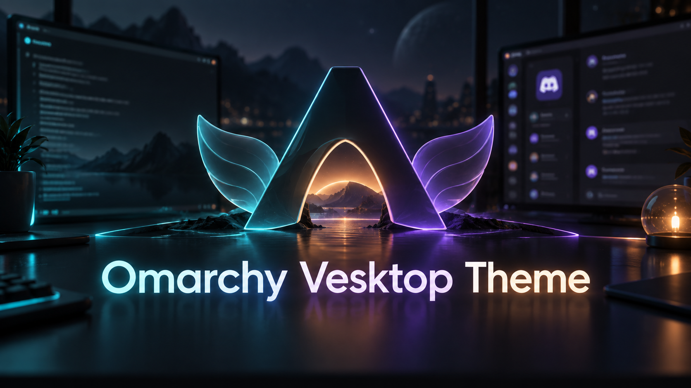

# Omarchy Vesktop Theme



An Omarchy service plugin that makes Vesktop look like the rest of the desktop
and follow the current theme without restarting the app.

- **Colors** come from the current theme's `vencord.theme.css`. Themes that
  don't ship one get it rendered from their `colors.toml` by a template the
  plugin installs in `~/.config/omarchy/themed/`.
- **Shape** comes from `style.theme.css`: panes as rounded windows with gaps and
  an accent border on the chat, square server icons, the system monospace
  font, thin dark scrollbars and no shadows.

Both are inlined into a single enabled Vencord theme, `Omarchy.theme.css`,
rewritten when the shell starts and by a `theme-set` hook on every theme
change. Vesktop reloads it live, without disconnecting calls.

## Install

```bash
omarchy plugin add https://github.com/FelipeMayerDev/omarchy-vesktop-theme --enable
```

Vesktop must have been opened at least once. The plugin does nothing when
Vesktop is not configured.

## Development

```bash
./tests/run
omarchy plugin validate .
```

Run `./sync` to regenerate the theme or re-enable it manually.
